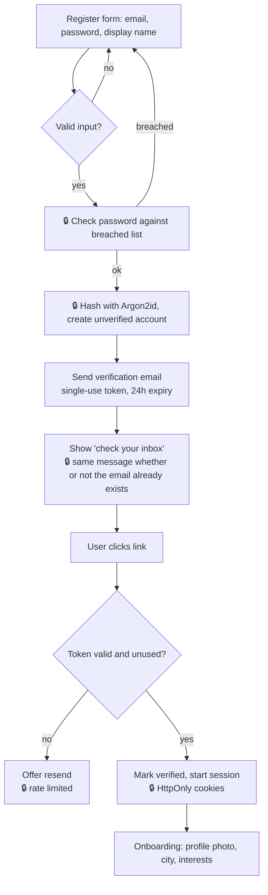
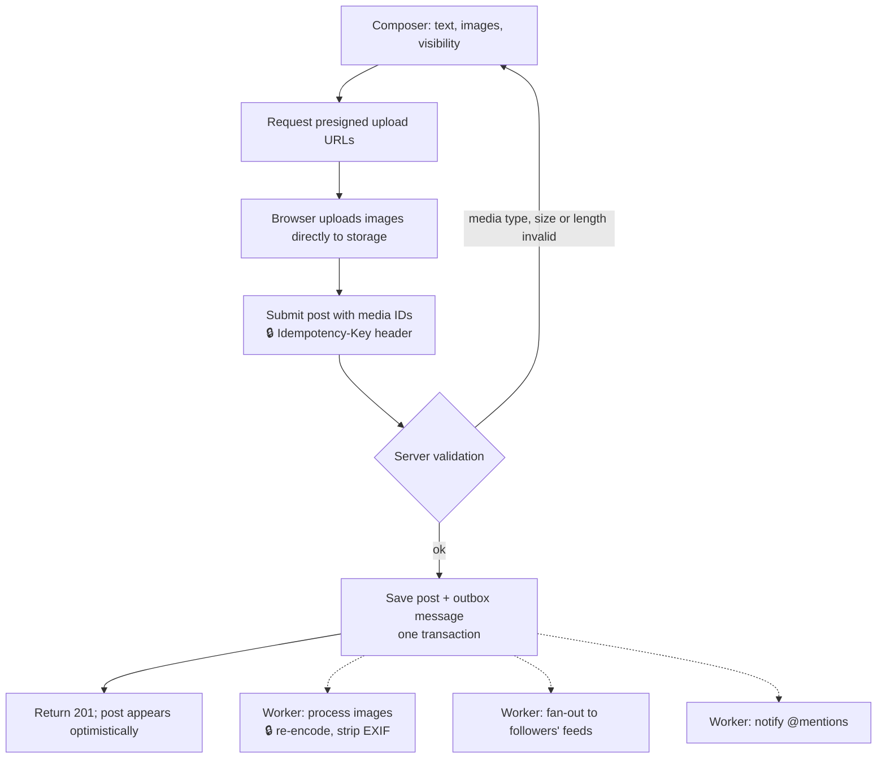
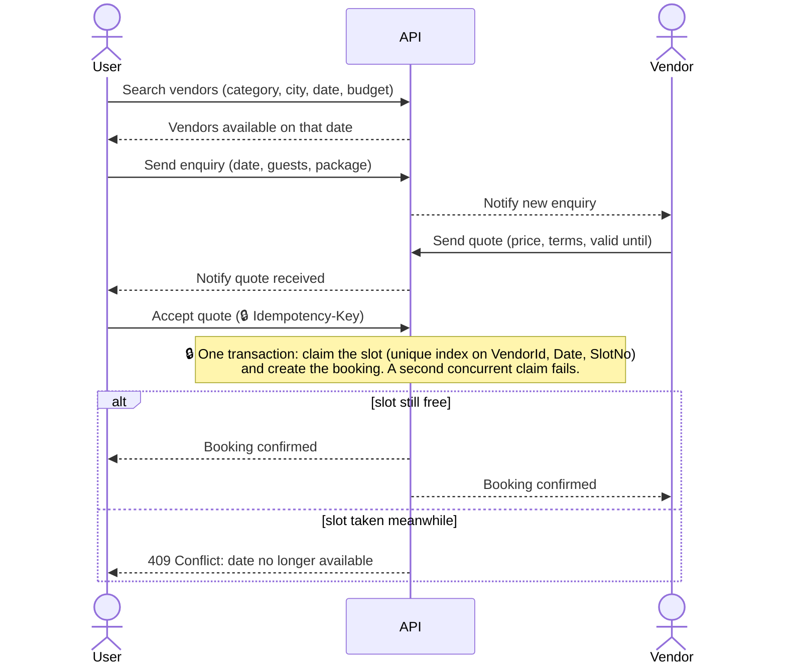
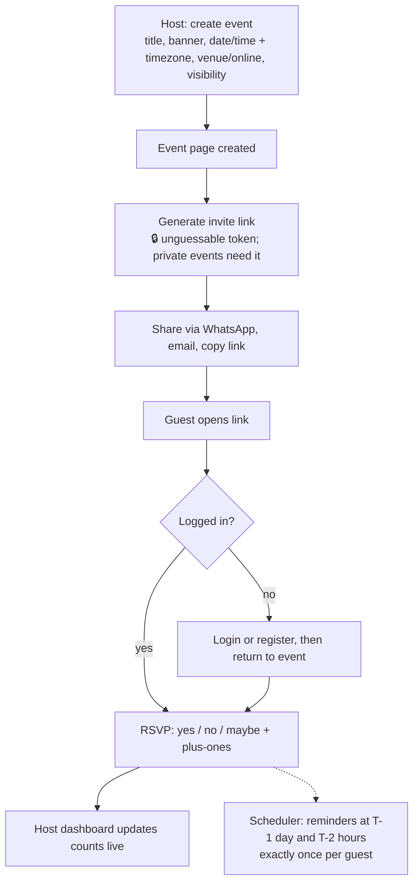
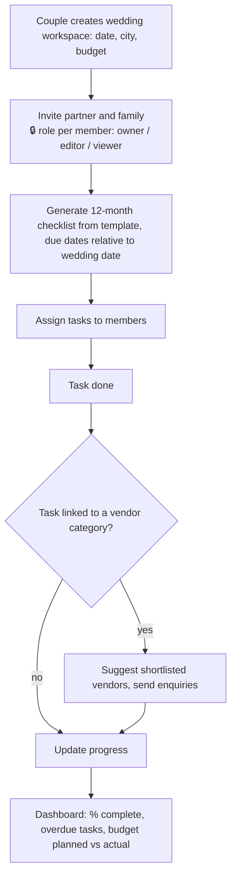

# Core User Flows

> **Draft for owner review.** Diagrams use Mermaid (they render on GitHub and in VS Code with a Mermaid extension).
> Security-relevant steps are marked 🔒.

## 1. Sign-up and email verification (US-01, US-02)

## 2. Create a post (US-12, US-13)

## 3. Book a vendor (US-30, US-31, US-32)

## 4. Create an event and collect RSVPs (US-34 to US-37)

## 5. Wedding checklist (post-MVP, Phase 11)

